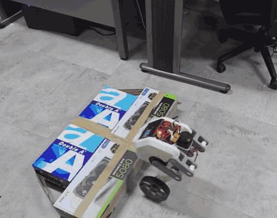
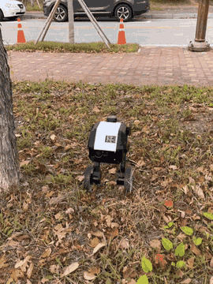
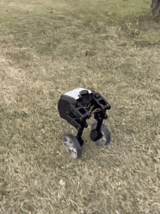
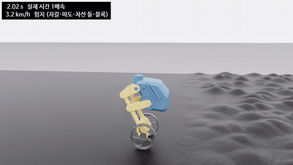
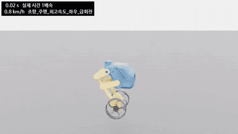
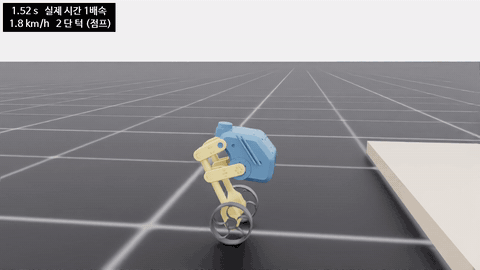
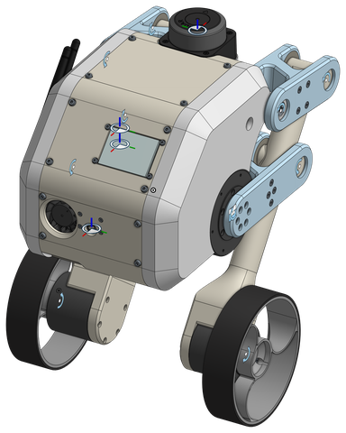
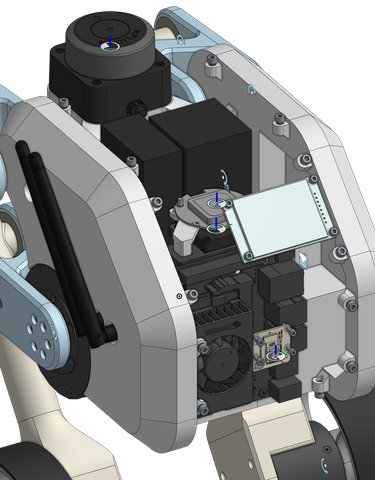
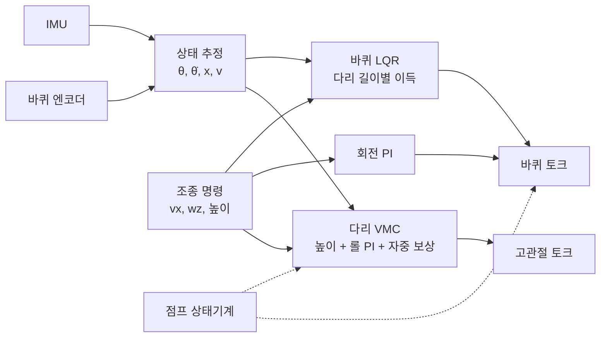

# PERSEVERANCE Gen2 (C-WANG)

4절 링크 다리를 가진 바퀴형 이족 로봇입니다. 두 바퀴로 균형을 잡고, 다리 길이를 바꿔 가며 험지를 달리고, 턱은 점프로 넘습니다.

**제4회 제2작전사령관배 드론봇 전투경연대회 로봇 2등 (민간부, 경상북도지사상)** — 2026.10.28~29, 팀 AXIS
지정한 전투원 한 명을 마커 없이 카메라로 따라가면서, 미끄러운 합판 계단(1일차 6cm, 2일차 8cm)을 점프로 올라갔습니다.


<p align="center">
  
  
  
</p>

## 개요

연구 주제는 **LQR과 가상 모델 제어(VMC)를 이용한 4절 링크 바퀴형 이족 로봇의 균형 및 주행 제어**입니다.

바퀴는 평지에서 빠르지만 턱을 못 넘고, 다리는 턱을 넘지만 느립니다. 바퀴 달린 다리는 둘의 장점을 합칠 수 있지만, 다리 길이가 계속 바뀌는 역진자를 세운 채로 점프까지 해야 합니다. 이 프로젝트에서 확인하고 싶었던 건 세 가지입니다.

1. 다리 길이가 바뀌어도 이득 스케줄 LQR 하나로 균형과 주행이 되는지
2. 다리(높이·롤)와 바퀴(균형·회전)를 VMC로 나눠 맡겨도 험지나 점프에서 서로 간섭하지 않는지
3. 시뮬레이션에서 고른 제어기가 실기의 지연, 백래시, 모터 출력 손실 아래에서도 버티는지, 버티지 못한다면 무엇 때문인지

제어기는 `wbctrl.py` 하나를 시뮬레이션에서 설계·검증하고, 같은 내용을 C++(`wb_core`)로 옮겨 로봇에서 돌립니다. 점프 파라미터는 실기 로그에 맞춰 보정한 시뮬레이션 위에서 CMA-ES로 찾았습니다.

| 거친 지형 (돌·물결, 최대 6cm) | 최고 속도 지그재그 (3.5km/h) | 8cm 턱 두 번 점프 |
|---|---|---|
|  |  |  |

<sub>Isaac Lab, 실시간 속도. 실기와 같은 제어기에 실측 바퀴 마찰, 모델 오차, 센서 잡음을 넣은 상태입니다.</sub>

## 하드웨어

| 항목 | 사양 |
|---|---|
| 질량 | 4.17kg |
| 다리 | 4절 링크 2개, 고관절 CubeMars AK60-6 V3.0 (MIT 모드). 다리 높이 0.1225~0.2425m |
| 바퀴 | CubeMars AK45-10 직결 2개, 반지름 70mm, 좌우 간격 약 198mm |
| 컴퓨터 | Jetson Orin Nano 8GB, Ubuntu 24.04, ROS 2 Jazzy, Cyclone DDS |
| 센서 | iAHRS IMU (500Hz), RPLIDAR C1, IMX219 광각 카메라 (어안 보정 후 가로 124°), NEO-M8N GNSS, PM02 전력계 2개 (ESP32-C3 센서 허브) |
| 통신 | CAN 1Mbit/s (모터 4개), 제어 주기 200Hz |

<p align="center">
  
  
</p>

Onshape에서 설계한 CAD를 URDF(폐루프 관절 포함)로 뽑아 Isaac Sim 5.1에 넣었습니다. 4절 링크 치수는 계단을 오를 수 있는지를 목적함수로 두고 최적화했습니다. 자세한 내용은 [CAD 문서](docs/lab-meeting/hardware/01_cad.md)에 있습니다.

## 제어 구조



- **바퀴 LQR**: 상태는 진행 거리, 속도, 진자각, 각속도 네 개입니다. 가상 다리 길이 0.12~0.40m 구간에서 미리 풀어 둔 이득 표를 보간해서 씁니다.
- **다리 VMC**: 4절 링크 자코비안으로 가상 다리 힘을 고관절 토크로 바꿉니다. 높이 추종, 롤 수평 PI, 자중 피드포워드가 들어갑니다.
- **점프**: 웅크림, 신전, 비행, 착지 등 6단계 상태기계입니다. 공중에서는 바퀴를 반작용 휠처럼 써서 몸통 pitch를 잡습니다([규격](comms/to-robot/attachments/jump_state_machine.md)). 파라미터는 시뮬레이션에서 로봇 2048대를 동시에 돌려 CMA-ES로 골랐습니다.
- **턱 감지 모드**: 천천히 다가가다 바퀴가 막히면 조금 물러났다가 다시 달려서 점프합니다. 조종하는 사람은 앞으로 밀기만 하면 되고, 스틱을 놓으면 취소됩니다.
- **사람 추종**: YOLO11n-pose(TensorRT), ByteTrack, OSNet ReID를 묶어서 지정한 한 명만 따라갑니다. 옷이 같은 사람이 섞여도 놓치지 않게, 사라진 방향을 기준으로 다시 찾습니다. 거리는 사람 영역 안의 LiDAR 점으로 재고, LiDAR가 안 잡히면 발 위치를 바닥에 투영해서 구합니다. 장애물과 미로 모퉁이는 Nav2로 돌아갑니다. 최고 0.7m/s.
- **자동 턱 넘기**: 따라가는 중에 카메라 영상에서 턱 선을 찾으면 1.5m 앞에서 속도를 줄이고, 0.5m 앞에서 턱 감지 모드로 바꿔 스스로 넘습니다.
- **수신호**: 대회 규정대로 정지와 재시작만 씁니다. 가까이서는 손 모양, 멀리서는 몸 자세(한 팔 위로 들기 = 정지, 두 팔 벌리기 = 재개)로 판단합니다.
- **점프 세트 전환**: `gen2_tune.sh <세트>`로 기본, 합판, 12N·m 세트를 바꿉니다. 관제 GUI에서도 고를 수 있습니다.

모든 판단과 주행은 Jetson에서 하기 때문에 Wi-Fi가 끊겨도 로봇은 멈춰서 균형을 유지합니다.

## 대회

제4회 제2작전사령관배 드론봇 전투경연대회에 나가 로봇 부문 2등(민간부)을 했습니다. 1등은 4족 보행 로봇 팀이었습니다.

| 미션 | 내용 | 대응 |
|---|---|---|
| 험지 | 사람을 따라가며 2단 계단(6cm / 8cm, 합판), 좌우 웨이브(12° / 14°) 통과 | 턱 감지 점프, 자동 턱 넘기, 합판용 점프 세트, 롤 제어 |
| 다중 객체 추적 | 두 명 중 지정한 한 명만 따라가기, 상자 피하기 | ReID + 방향 기준 재탐색, LiDAR 정지, Nav2 |
| 수신호 | 정지 지점에서 멈췄다가 다시 따라가기 | 손 모양 + 몸 자세 |
| 복합 경로 | 미로형 통로, 주행 시간 측정 | 모퉁이 Nav2, 가려졌을 때 탐색 |

규정상 마커는 쓸 수 없어서 사람 자체를 인식해야 했고, 수신호는 정지와 재시작에만 쓸 수 있었습니다.

### 합판 계단 대응

1일차 계단이 미끄러운 합판이라 2단째 착지에서 앞으로 넘어졌습니다(6cm 1단만 성공). 그날 밤 시뮬레이션에서 턱 마찰을 낮춰(바퀴 0.5~0.8 × 턱 0.7) 착지와 턱 감지 파라미터를 다시 찾았고, 2일차(8cm)는 이 합판 세트로 나갔습니다.

| 2단 8cm 성공률 (시뮬 2048회) | 턱 마찰 0.5 | 0.7 (합판) | 1.0 |
|---|---|---|---|
| 기본 세트 | 0.5% | 35.2% | 73.5% |
| 합판 v1 (착지 13개) | 17.3% | 58.4% | 58.4% |
| 합판 v3 (+ 후진·재진입·발사 4개) | 23.2% | 67.3% | 86.9% |
| **합판 v4** (+ 착지 시간·다리 강성, 19개) | **31.5%** | **72.0%** | **89.2%** |

착지 순간 pitch가 -15°에서 -7°로 줄었습니다. 남은 실패는 대부분 착지 직후 앞으로 미끄러지는 경우라 마찰 자체의 한계로 보고 있습니다. 기록은 [`sim/isaaclab/runs/2026-10-28_plywood`](sim/isaaclab/runs/2026-10-28_plywood/README.md), 세트 파일은 [`balance_tune_plywood.yaml`](src/gen2_control/config/balance_tune_plywood.yaml)입니다.

## 결과

### 시뮬레이션

로봇마다 질량 ±15%, 무게중심 ±2cm, 센서 잡음과 바이어스를 무작위로 넣고 평가했습니다(지연 5ms 기준).

| 평가 | 성공 |
|---|---|
| 험지 9종, 4096대 × 20초 | 98.9% |
| 시나리오 11종 (정지, 회전, 턱, 경사, 점프, 밀기 등) | 167 / 176 |

### 실기 균형·주행 (2026.10.08)

- 손 대지 않고 10~20초 균형, 0.1m/s 전후진
- 제자리 회전: 명령 ±0.5 / ±1.0rad/s에 대해 +0.49 / -0.51 / +1.03 / -1.00rad/s
- 롤 PI: 평지, 옆에서 밀기, 한쪽 바퀴만 경사로에서 진동 없음
- 제어 주기 5.00ms(p99 5.02ms), 바퀴 토크 명령에서 응답까지 지연 10ms

### 실기 점프

| 날짜 | 조건 | 결과 |
|---|---|---|
| 10.14 | 평지, 고관절 명령 상한 8.1N·m | 20회 중 15회 성공, 바퀴 높이 약 5.6cm |
| 10.15 | 평지, 상한 12N·m | 넘어짐 없음 (조작 실수 제외) |
| 10.23~24 | 10cm 턱, 상한 15N·m, 턱 감지 모드 14회 | 막힘 판정, 후진, 재가속 모두 정상. 다만 착지 pitch가 -15~-23°로 뒤로 젖혀진 채 후진 |

실기 모터는 명령보다 힘을 덜 냅니다. 바퀴는 명령의 0.83배, 고관절은 점프로 다리를 펼 때 명령의 약 35%(전류 기준)였습니다. 이 값을 시뮬레이션에 넣고 나서야 실기에서 실패한 장면이 시뮬레이션에서도 똑같이 재현됐습니다.

<details><summary>대회 전: 착지할 때 뒤로 젖혀지는 문제 (2026.10.24)</summary>

이상적인 시뮬레이션에서는 2단 계단 성공률이 97~99%였지만, 실기 로그로 시뮬레이션을 보정하자(고관절 신전 105ms, 경사 보상, 실기 수준의 재가속 속도) 실기와 똑같이 착지 pitch -16°로 젖혀지는 현상이 나왔습니다.

| 코스 | 성공 | 넘어짐 |
|---|---|---|
| 2단 8cm | 74.4% | 25.2% |
| 단 10cm | 87.5% | 12.5% |
| 단 12cm | 83.3% | 15.3% |

같은 조건에서 착지 파라미터를 다시 찾았고(착지 pitch와 착지 후 후진에 벌점), 이 작업이 대회 중 합판 세트로 이어졌습니다.

</details>

<details><summary>그 이전: 제어 지연 (2026.10.08)</summary>

시뮬레이션을 실측값(지연 10+5ms, 감속기 백래시 0.3°, 실기 고관절 구조)으로 바꾸고 이득은 그대로 두었을 때, 88대 중 성공 수입니다.

| 조건 | 성공 |
|---|---|
| 실기 조건 그대로 | 48 / 88 |
| 지연만 이상값(5ms)으로 | 69 / 88 |
| 백래시만 끔 | 52 / 88 |
| 고관절만 이상 PD | 50 / 88 |
| 전부 이상값 | 67 / 88 |

성능 차이 대부분은 제어 지연(5ms에서 10ms로)에서 왔습니다.

</details>

## 폴더 구조

```text
perseverance
├── sim                      시뮬레이션·설계 (데스크톱)
│   ├── isaaclab/scripts     wbctrl.py (제어기), climb_test.py (전체 파라미터), 평가·CMA-ES 스크립트
│   ├── isaaclab/runs        대회 중 튜닝 기록
│   ├── model                URDF, LQR·4절 링크 표
│   └── control              VMC + LQR 이득 설계
├── src                      ROS 2 패키지 (Jetson)
│   ├── gen2_control         balance_node (200Hz), wb_core
│   ├── gen2_hardware        SocketCAN, CubeMars AK 프로토콜
│   ├── gen2_sensor_hub      ESP32-C3 센서 허브 드라이버
│   ├── gen2_camera          IMX219 영상
│   ├── gen2_status_display  LCD 상태 화면
│   ├── gen2_tools           조종, 사람 추종, 자동 턱 넘기, 수신호, 시험 도구
│   └── gen2_bringup         launch, DDS 설정, systemd
├── tools                    관제 노트북 GUI, 추종 실행 스크립트, 데스크톱 HUD
├── firmware                 ESP32 센서 허브 펌웨어
├── system                   Jetson 시스템 설정
├── logs                     실기 기록 (200Hz)
├── comms                    데스크톱·로봇·관제 노트북 사이 작업 기록
└── docs                     랩미팅 자료, 확장요약문, 운용 문서
```

## 실행

**로봇 (Jetson)**: 빌드와 모터 시험은 [실기 문서](docs/robot_bench.md), 전원 켜는 순서는 [운용 흐름](docs/operation_flow.md)을 참고하세요.

```bash
cd ~/gen2_ws && source /opt/ros/jazzy/setup.bash
colcon build --cmake-args -DCMAKE_BUILD_TYPE=Release
ros2 launch gen2_control balance.launch.py
```

**관제 노트북**: [`tools/gcs`](tools/gcs/README.md)

```bash
bash ~/perseverance/tools/gcs/setup_gcs.sh
```

**시뮬레이션 (데스크톱)**: Isaac Lab 2.3.2를 설치한 뒤 `sim/isaaclab`을 프로젝트로 씁니다. 파라미터는 `climb_test.py` 맨 위에 모여 있습니다.

```bash
pv demo <scene>   # 한 대 띄워서 보기 (rough, steer, jump ...)
pv robust         # 시나리오 11종
pv harsh          # 수천 대 가혹 평가
```

**조종**

```bash
source ~/gen2_desk/env.sh
ros2 run joy joy_node --ros-args -p autorepeat_rate:=20.0
ros2 run gen2_tools pad_teleop
```

| 패드 | 동작 |
|---|---|
| START | 일어서서 균형 |
| BACK | 앉기 |
| LB + RB | 비상 해제 |
| Y | 점프 (0.2m/s 이상 전진 중) |
| 십자키 ↑ | 턱 감지 모드 켜기/끄기 |
| 십자키 ↓ | 따라가는 중 자동 턱 넘기 켜기/끄기 |

**사람 추종**: 관제 GUI에서 켜거나 직접 실행합니다.

```bash
bash ~/perseverance/tools/robot/run_follow_cam.sh
gen2_tune.sh plywood   # 점프 세트: plywood | hip12 | default
```

좌표는 전진 +x, 왼쪽 +y, 위 +z입니다. θ는 몸이 앞으로 기울면 +, 바퀴 토크가 +면 전진입니다.

## 문서

- [랩미팅 자료](docs/lab-meeting/README.md)
- [확장요약문 (PDF)](docs/abstract/extended_abstract_lqr_vmc.pdf)
- [운용 흐름](docs/operation_flow.md), [실기 문서](docs/robot_bench.md), [시뮬레이션 자산](sim/README.md)
- [제어기 구조](docs/controller_structure.md), [점프 상태기계](comms/to-robot/attachments/jump_state_machine.md)

## 만든 사람

**박수호** ([@AkimaraYouki](https://github.com/AkimaraYouki)) — 금오공과대학교 스마트모빌리티공학, AIAS Lab 학부연구생

기구 설계(4절 링크 치수 최적화, CAD, 3D 프린팅)부터 전장과 하드웨어 통합, 제어기 설계, 시뮬레이션과 sim2real, ROS 2 소프트웨어, 사람 추종과 자동 턱 넘기, 실험과 대회 운용까지 혼자 개발했습니다.

지도교수: 손정우 교수 (AIAS Lab)

라이선스는 아직 정하지 않았습니다. 정하기 전까지 모든 권리는 저작자에게 있습니다.
