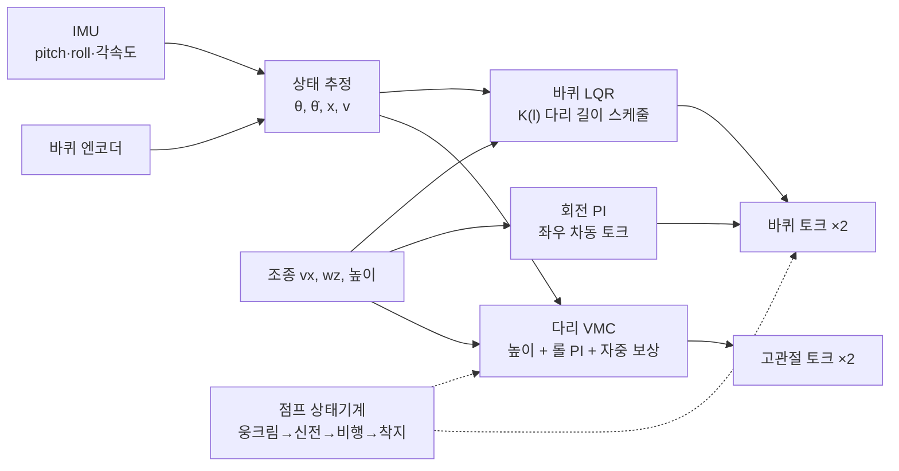

# PERSEVERANCE Gen2 (C-WANG) — 4절 링크 바퀴형 이족 로봇
**두 바퀴로 균형을 잡고, 다리를 늘였다 줄여 험지를 달리고, 점프로 턱을 넘는다.**


<p align="center">
  
  
  
</p>

---

## 📖 목차 (Table of Contents)
- [프로젝트 소개](#-프로젝트-소개-about-the-project)
- [주요 기능](#-주요-기능-key-features)
- [결과](#-결과-results)
- [폴더 구조](#-폴더-구조-directory-structure)
- [시작하기](#️-시작하기-getting-started)
- [사용법](#-사용법-usage)
- [기여하기](#-기여하기-contributing)
- [문서](#-문서-documentation)
- [라이선스](#-라이선스-license)
- [Contact](#-contact)

---

## 🚀 프로젝트 소개 (About The Project)

**LQR 과 가상 모델 제어(VMC)를 이용한 4절 링크 바퀴형 이족 로봇의 균형 및 주행 제어**
*Balance and locomotion control of a wheeled bipedal robot with four-bar legs using LQR and virtual model control.*

**배경.** 바퀴는 평지에서 빠르고 효율적이지만 턱·계단을 못 넘고, 다리는 넘을 수 있지만 느리고 복잡하다.
바퀴 달린 다리는 둘을 합치지만, 다리 길이가 계속 바뀌는 역진자를 균형 잡으면서 점프까지 해야 한다.
이 로봇은 사람 추종 보급 로봇 대회 (계단 6 / 8 cm, 웨이브 12 / 14°) 를 목표로 만들었다.

**풀려는 문제.**
1. **4절 링크 다리 + 바퀴** 구조에서, 다리 길이가 바뀌어도 하나의 선형 제어기(이득 스케줄 LQR)로 균형·주행이 되는가?
2. 다리(높이·롤)와 바퀴(균형·회전)를 **VMC 로 나눠** 맡겨도 험지·점프에서 서로 방해하지 않는가?
3. 시뮬레이션에서 고른 제어기가 **실기의 지연·백래시·모터 출력 손실** 아래에서도 같은 성능을 내는가 — 무엇이 차이를 만드는가?

**접근.** 제어기 **하나** (`wbctrl.py`) 를 시뮬레이션에서 설계·검증하고, 그 규격을 그대로 C++ 로 옮겨 실기에서 돌린다.
점프 파라미터는 실기 로그에 맞춘 시뮬 플랜트 위에서 CMA-ES 로 고른다.

| 거친 지형 (돌·물결, 최대 6 cm) | 최고 속도 지그재그 (3.5 km/h) | 8 cm 턱 두 번 점프 |
|---|---|---|
|  |  |  |

<sub>Isaac Lab, 실시간 1×. 실기와 같은 제어기, 실측 바퀴 마찰·모델 오차·센서 잡음 포함 (`pv demo <scene> --record`).</sub>

### 로봇

| 항목 | 사양 |
|---|---|
| 질량 | 4.17 kg (URDF 전체) [계산] |
| 다리 | 4절 링크 ×2, 고관절 **CubeMars AK60-6 V3.0** (MIT 모드). 다리 높이 h 0.1225 – 0.2425 m (고관절~바퀴 중심 0.19 – 0.31 m) |
| 바퀴 | **CubeMars AK45-10** 직결 ×2 (legacy MIT 모드), 반지름 70 mm, 바퀴 간격 ≈ 198 mm, 바퀴 72.5 g (고무 16.5 g) [측정] |
| 컴퓨터 | Jetson Orin Nano 8 GB · Ubuntu 24.04 · ROS 2 Jazzy · Cyclone DDS |
| 센서 | iAHRS IMU (500 Hz), RPLIDAR C1, IMX219 카메라, NEO-M8N GNSS + 지자기, PM02 전력계 ×2 (ESP32-C3 센서 허브) |
| 버스 | CAN 1 Mbit/s (모터 4 개), 제어 200 Hz |

<p align="center">
  
  
</p>
<p align="center"><sub>CAD — 왼쪽: 정면, 오른쪽: 전장부.</sub></p>

CAD (Onshape) → URDF + 폐루프 관절 → Isaac Sim 5.1. 4절 링크 치수는 계단 등반 조건을 목적함수로 최적화했다 ([하드웨어 ① CAD](docs/lab-meeting/hardware/01_cad.md)).

## ✨ 주요 기능 (Key Features)



* **바퀴 LQR** — 상태 [진행거리 x, 속도 v, 진자각 θ, 각속도 θ̇], 가상 다리 길이 l 0.12 – 0.40 m 에서 미리 푼 이득 표를 보간.
* **다리 VMC** — 4절 링크 자코비안으로 가상 다리 힘 → 고관절 토크. 높이 추종, 롤 수평 PI, 자중 피드포워드.
* **점프** — 6 단계 상태기계, 공중에서는 바퀴를 반작용 휠로 써서 몸통 pitch 를 잡는다 ([규격](comms/to-robot/attachments/jump_state_machine.md)).
  파라미터 (웅크림 시간·신전 자세·공중 게인·착지 판정 등) 는 시뮬 2048 대 병렬 CMA-ES 로 고르고, 점수는 성공률 − 넘어짐 − 착지 벌점 (다리 바닥 닿음·바퀴 하중·착지 pitch·착지 뒤 후진).
* **턱 감지 모드** — 천천히 다가가 막히면 (바퀴가 멈춤) 일정 거리 물러났다가 다시 가속해 스스로 점프한다. 조종자는 앞으로 밀기만 하면 되고, 스틱을 놓으면 취소.
* **경사 보상** — 정상 주행 중 속도 오차를 적분해 속도 목표를 올린다 (경사로·바퀴 손실 보상).
* **하나의 제어기 원칙** — 시뮬 창 (1 대) · 시험 세트 (수십 대) · 가혹 평가 (4096 대) 가 모두 같은 [`wbctrl.py`](sim/isaaclab/scripts/wbctrl.py) (로봇 N 대 배열) 를 쓰고, 실기 [`wb_core`](src/gen2_control/src/wb_core.cpp) 는 그 C++ 이식이다 (골든 테스트로 출력 일치 확인).
* **관제** — 패드 조종, HUD (턱 감지 모드 STEP 배지), 상태판, SLAM 을 데스크톱·관제 노트북에서. 판단·주행은 전부 젯슨이라 Wi-Fi 가 끊겨도 로봇은 안전하게 멈춘다.

## 📊 결과 (Results)

수치 표기: **[측정]** 시뮬·실기에서 잰 값 / **[설정]** 코드 값 / **[계산]** 식으로 낸 값.

### 시뮬레이션 — 이상적 플랜트 (5 ms 지연, 서보 바퀴 데드밴드 + 보상)
로봇마다 질량 ±15 %, 무게중심 ±2 cm, 센서 잡음·바이어스를 무작위로 넣었다 [측정, 확장요약문].

| 평가 | 성공 |
|---|---|
| 험지 9 종, 4096 대 × 20 s | **98.9 %** |
| 시나리오 11 종 (정지·회전·턱·경사·점프·밀기 등) 176 회 | **167 / 176** |

### 실기 — 균형·주행 (2026-10-08) [측정]
- 손 안 대고 10 – 20 s 균형, 0.1 m/s 전후진.
- 제자리 회전: 명령 ±0.5 / ±1.0 rad/s → +0.49 / −0.51 / +1.03 / −1.00 rad/s (회전 적분 추가 후).
- 롤 PI (0.5 / 3 / 0): 평지·옆 밀기·한쪽 바퀴 경사로에서 진동 없음.
- 루프: 200 Hz, 주기 중앙 5.00 ms (p99 5.02). 보낸 바퀴 토크 → 응답 토크 지연 **10 ms**, 바퀴 상태 나이 4.1 ms.

### 실기 — 점프 [측정]
| 날짜 | 조건 | 결과 |
|---|---|---|
| 10-14 | 평지, CMA 7 묶음, 고관절 명령 상한 8.1 N·m | 20 회 중 15 회 성공, 바퀴 높이 ≈ 5.6 cm |
| 10-15 | 평지, CMA 11 묶음, 상한 12 N·m | 넘어짐 없음 (조작 실수 제외) |
| 10-23 – 24 | 10 cm 턱, 상한 15 N·m, 턱 감지 모드 자동 12 회 + 수동 2 회 | 막힘 판정·후진·재가속 오판 없음. 착지 pitch **−15 … −23°** (중간 −19°) 로 뒤로 젖혀진 채 후진 (중간 −0.78 m/s) |

실기에서 드라이브는 명령보다 적게 낸다 — 바퀴 0.83 배, 고관절은 점프 신전 때 명령의 약 35 % (전류 기준). 이 값들을 시뮬 플랜트에 넣은 뒤에야 시뮬이 실기 실패를 재현했다.

### 지금의 연구 과제 — 착지 젖혀짐 (2026-10-24)
대회 2 단 계단 (6 / 8 cm) 에서 턱 감지 모드는 이상 플랜트 시뮬 97 – 99 % 였지만, 실기 로그로 플랜트를 다시 맞추자 (고관절 신전 105 ms, 경사 보상, 재가속 속도 실기 수준) 착지 pitch −16° 로 실기와 같은 젖혀짐이 나왔다 [측정, 2048 판씩]:

| 코스 | 성공 | 넘어짐 |
|---|---|---|
| 2 단 8 cm | 74.4 % | 25.2 % |
| 단 10 cm | 87.5 % | 12.5 % |
| 단 12 cm | 83.3 % | 15.3 % |

→ 같은 실기 플랜트에서 착지 파라미터 (13 개) 와 균형 LQR 이득 배율을 CMA-ES 로 다시 고르는 중. 목적함수에 착지 pitch 와 착지 뒤 후진 속도 벌점을 넣었다.

<details><summary>이전 과제 (2026-10-08) — 제어 지연</summary>

시뮬 기본값을 실기 측정값 (MIT 바퀴, 지연 10 + 5 ms, 감속기 백래시 0.3°, 고관절 MIT 구조) 으로 바꾸고 제어 이득은 이상값 그대로 두었을 때 [측정, 88 대]:

| 플랜트 | 성공 |
|---|---|
| 실기 플랜트 (현재 기본) | 48 / 88 |
| ↳ 지연만 이상값 (5 ms) | **69 / 88** |
| ↳ 백래시만 끔 | 52 / 88 |
| ↳ 고관절만 이상 PD | 50 / 88 |
| 전부 이상값 | 67 / 88 |

→ 성능 차이의 대부분은 **제어 지연 (5 → 10 ms)** 에서 온다. 다음 단계는 지연에 강건한 이득 (후보 C: K(0.2) = [−1.73, −2.80, −12.93, −1.64], 지연·백래시 모델에서 93/96) 과 무게중심 오차 민감도 개선, 그리고 실기 θ̇ 이득에서 보이는 15 Hz 바퀴 떨림의 원인 규명이었다.

</details>

## 📁 폴더 구조 (Directory Structure)
```text
📦 perseverance
 ┣ 📂 sim                    시뮬·설계 (데스크톱)
 ┃ ┣ 📂 isaaclab/scripts     wbctrl.py (제어기 규격), climb_test.py (TUNE 블록 = 모든 파라미터),
 ┃ ┃                         robust_suite.py, harsh_eval.py  · 점프 CMA-ES jump_rl.py 는 desktop/jump-rl 브랜치
 ┃ ┣ 📂 model                URDF, LQR·4절 링크 표 (balance_tables*.yaml), 발자국·센서 위치
 ┃ ┗ 📂 control              VMC + LQR 게인 설계
 ┣ 📂 src                    ROS 2 패키지 (젯슨)
 ┃ ┣ 📂 gen2_control         balance_node (200 Hz), wb_core (wbctrl 의 C++ 이식)
 ┃ ┣ 📂 gen2_hardware        SocketCAN, CubeMars AK 코덱
 ┃ ┣ 📂 gen2_sensor_hub      ESP32-C3 센서 허브 드라이버
 ┃ ┣ 📂 gen2_camera          IMX219 → 압축 영상
 ┃ ┣ 📂 gen2_status_display  SPI LCD 상태 화면
 ┃ ┣ 📂 gen2_tools           pad_teleop, cmd_mux, 시험·보정 도구
 ┃ ┗ 📂 gen2_bringup         launch, Cyclone DDS 설정, systemd 유닛
 ┣ 📂 tools
 ┃ ┣ 📂 gcs                  관제 노트북 GUI·설치 스크립트
 ┃ ┗ 📂 desktop              데스크톱 HUD (STEP 배지), 대시보드, RViz 설정
 ┣ 📂 firmware               ESP32 센서 허브 펌웨어
 ┣ 📂 system                 젯슨 systemd·네트워크·udev 설정
 ┣ 📂 logs                   실기 기록 CSV (200 Hz 스텝 기록)
 ┣ 📂 comms                  데스크톱 ↔ 젯슨 ↔ 관제 에이전트 우편함 (메시지 하나 = 파일 하나)
 ┣ 📂 docs                   랩미팅 자료, 확장요약문, 운용 흐름, 벤치 문서, 공급사 문서
 ┗ 📜 README.md
```

## ⚙️ 시작하기 (Getting Started)

### 사전 요구사항 (Prerequisites)
| 기기 | 환경 |
|---|---|
| 로봇 | Jetson Orin Nano 8 GB, Ubuntu 24.04, ROS 2 Jazzy, Cyclone DDS, CAN (can0 1 Mbit/s) |
| 시뮬 (데스크톱) | Ubuntu 22.04, RTX GPU, Isaac Sim 5.1 + Isaac Lab 2.3.2 |
| 조종 (데스크톱) | ROS 2 Humble + Cyclone DDS, 도메인 42, 게임패드 |
| 관제 노트북 | Ubuntu 24.04, ROS 2 Jazzy |

### 설치 및 실행 (Installation)
```bash
# 저장소 복제
git clone https://github.com/AkimaraYouki/perseverance.git ~/perseverance
```

**로봇 (젯슨)** — 빌드·부팅 서비스·모터 시험은 [실기 벤치 문서](docs/robot_bench.md), 전원 → 균형 순서는 [운용 흐름](docs/operation_flow.md).
```bash
cd ~/gen2_ws && source /opt/ros/jazzy/setup.bash
colcon build --cmake-args -DCMAKE_BUILD_TYPE=Release
colcon test && colcon test-result --verbose
ros2 launch gen2_control balance.launch.py      # balance_node + cmd_mux (부팅 때 자동, 해제 상태)
```

**관제 노트북** — 설치 스크립트 하나 (일반 Wi-Fi 에서, 10 – 20 분). 자세한 순서는 [`tools/gcs`](tools/gcs/README.md).
```bash
bash ~/perseverance/tools/gcs/setup_gcs.sh
```

**시뮬 (데스크톱)** — Isaac Lab 설치 뒤 `sim/isaaclab` 을 Isaac Lab 프로젝트로 쓴다. 자산 파이프라인은 [시뮬 자산](sim/README.md).

## 💻 사용법 (Usage)

**시뮬** — 파라미터는 `climb_test.py` 의 TUNE 블록에서 고친다.
```bash
pv demo <scene>        # 창 1 대 (rough, steer, jump …), --record 로 GIF
pv robust              # 시나리오 11 종 × 8 대
pv harsh               # 가혹 평가 (수천 대)
```

**조종 (데스크톱 ROS 2 Humble ↔ 로봇 Jazzy, Cyclone DDS, 도메인 42)**
```bash
source ~/gen2_desk/env.sh
ros2 run joy joy_node --ros-args -p autorepeat_rate:=20.0     # 터미널 1
ros2 run gen2_tools pad_teleop                                  # 터미널 2
```

| 패드 | 동작 |
|---|---|
| START | 시작 (서기 → 균형) |
| BACK | 앉기 |
| LB + RB | 비상 해제 |
| Y | 점프 (0.2 m/s 이상 전진 중) |
| 십자키 ↑ / ↓ | 턱 감지 모드 켜기 / 끄기 (켠 뒤 앞으로 밀기만, 스틱 놓으면 취소) |

**부호 규약** (전 파일 공통): 전진 +x, 왼쪽 +y (REP-103), 위 +z. θ 는 윗부분이 앞으로 기울면 +. 양의 바퀴 토크 → 전진.

## 🤝 기여하기 (Contributing)
데스크톱 (시뮬)·젯슨 (로봇)·관제 노트북이 각자 브랜치에서 작업하고 `main` 으로 합친다.
1. 브랜치는 담당별로: `desktop/<주제>`, `robot/<주제>`.
2. 제어기 수정은 `wbctrl.py` 한 곳에서 하고, 로봇은 같은 내용을 `wb_core` 로 이식한 뒤 골든 테스트로 일치를 확인한다.
3. 파라미터는 TUNE 블록 (`climb_test.py`) / `balance.yaml` 에 모으고, 바꿀 때는 이전 값과 근거 (측정·시뮬 결과) 를 주석으로 남긴다.
4. 다른 기기에 부탁·보고할 일은 [`comms/`](comms/README.md) 에 파일 하나로 (근거 수치·파일 경로·커밋 포함).
5. Pull Request 로 `main` 에 합친다.

## 📚 문서 (Documentation)
- [랩미팅 자료](docs/lab-meeting/README.md) — 학습·통신·ROS 2·제어 / CAD·센서·액추에이터
- [확장요약문 (PDF)](docs/abstract/extended_abstract_lqr_vmc.pdf)
- [운용 흐름](docs/operation_flow.md) · [실기 벤치·운용 참고](docs/robot_bench.md) · [시뮬 자산](sim/README.md)
- [실기 제어기 구조](docs/controller_structure.md) · [젯슨 / 데스크톱 역할 분배](docs/roles.md)
- [점프 상태기계 규격](comms/to-robot/attachments/jump_state_machine.md)

## 📜 라이선스 (License)
아직 라이선스를 정하지 않았다 (`LICENSE` 파일 없음). 정해지기 전까지 모든 권리는 저작자에게 있다.

## 📬 Contact
* parksuho (스마트모빌리티 학부연구생) — GitHub [@AkimaraYouki](https://github.com/AkimaraYouki)
* 프로젝트 링크: [github.com/AkimaraYouki/perseverance](https://github.com/AkimaraYouki/perseverance)
